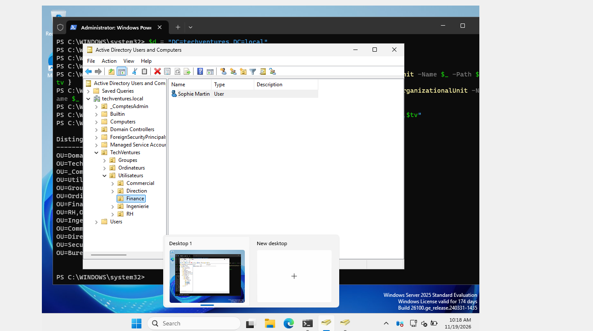
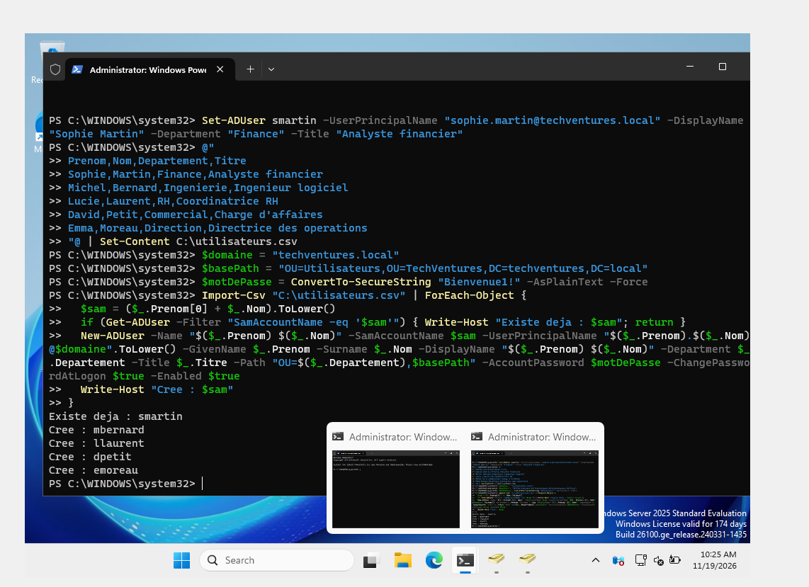
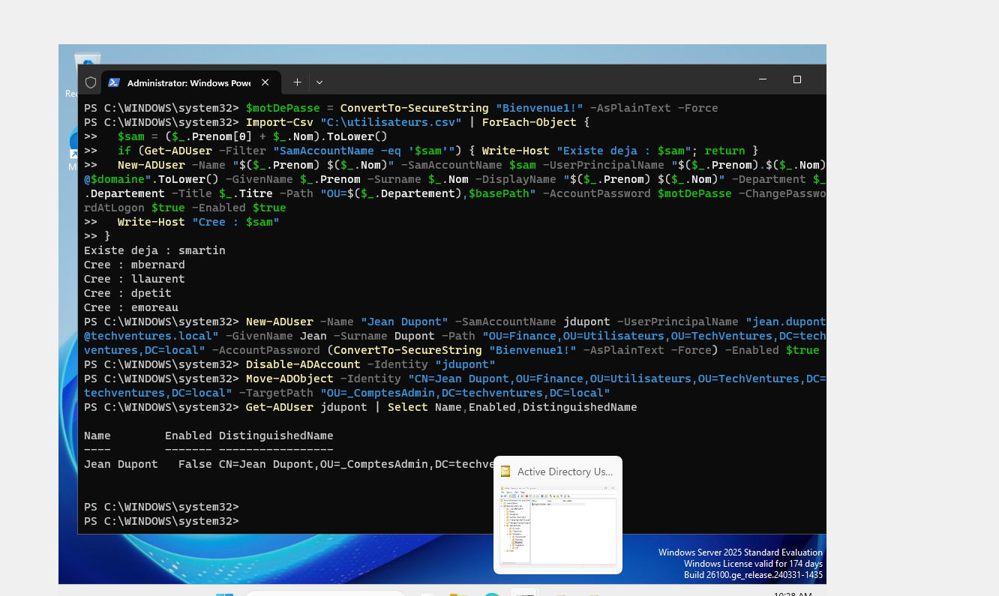
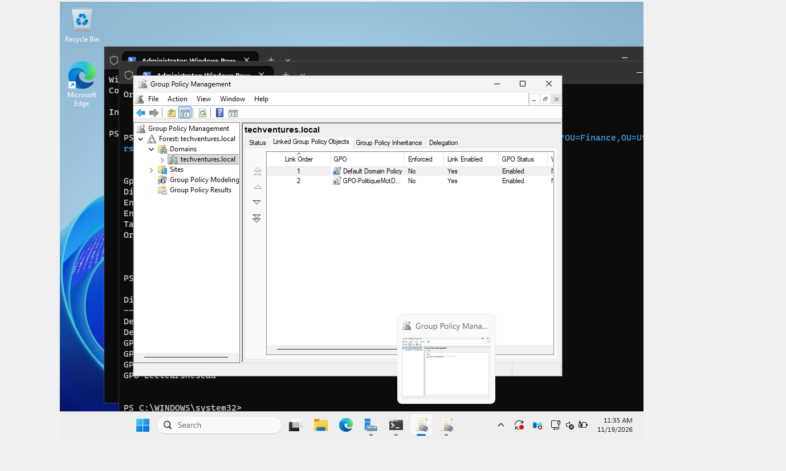
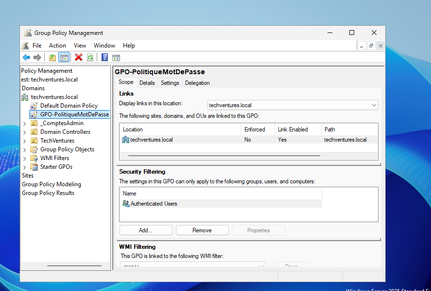

# 300151315 - Windows Server : domaine TechVentures

Laboratoire d'administration Windows Server réalisé par **Toumi Ayoub**.

## Environnement

| Élément | Valeur |
|---------|--------|
| Hyperviseur | VirtualBox |
| Serveur | `DC01` — Windows Server 2025 Standard (évaluation) |
| Rôles | AD DS (contrôleur de domaine) + DNS |
| Domaine | `techventures.local` (NetBIOS `TECHVENTURES`) |

> Une seule VM a été utilisée : les partages prévus sur `FS01` ont été créés sur `DC01`, et la partie 10 (poste client) n'a pas été réalisée.

## Unités d'organisation (OU)

```powershell
$d = "DC=techventures,DC=local"
New-ADOrganizationalUnit -Name "TechVentures" -Path $d
New-ADOrganizationalUnit -Name "_ComptesAdmin" -Path $d
$tv = "OU=TechVentures,$d"
"Utilisateurs","Groupes","Ordinateurs" | % { New-ADOrganizationalUnit -Name $_ -Path $tv }
"Finance","RH","Ingenierie","Commercial","Direction" | % { New-ADOrganizationalUnit -Name $_ -Path "OU=Utilisateurs,$tv" }
New-ADOrganizationalUnit -Name "Securite" -Path "OU=Groupes,$tv"
New-ADOrganizationalUnit -Name "Bureautique" -Path "OU=Ordinateurs,$tv"
```

```
techventures.local
├── _ComptesAdmin
└── TechVentures
    ├── Utilisateurs
    │   ├── Finance
    │   ├── RH
    │   ├── Ingenierie
    │   ├── Commercial
    │   └── Direction
    ├── Groupes
    │   └── Securite
    └── Ordinateurs
        └── Bureautique
```

## Partie 7 — Comptes utilisateurs

Convention de nommage : SAM = initiale du prénom + nom (`smartin`), UPN = `prenom.nom@techventures.local`, mot de passe temporaire `Bienvenue1!` avec changement obligatoire à la première connexion.

### Étape 1 — Création par l'interface graphique

Sophie Martin créée dans **Utilisateurs et ordinateurs Active Directory** (`dsa.msc`), OU `Finance`.



### Étape 2 — Création en masse (CSV + PowerShell)

`C:\utilisateurs.csv` :
```
Prenom,Nom,Departement,Titre
Sophie,Martin,Finance,Analyste financier
Michel,Bernard,Ingenierie,Ingenieur logiciel
Lucie,Laurent,RH,Coordinatrice RH
David,Petit,Commercial,Charge d'affaires
Emma,Moreau,Direction,Directrice des operations
```

Le script ignore un compte qui existe déjà (Sophie, créée à l'étape 1) :

```powershell
Import-Csv "C:\utilisateurs.csv" | ForEach-Object {
  $sam = ($_.Prenom[0] + $_.Nom).ToLower()
  if (Get-ADUser -Filter "SamAccountName -eq '$sam'") { Write-Host "Existe deja : $sam"; return }
  New-ADUser -Name "$($_.Prenom) $($_.Nom)" -SamAccountName $sam `
    -UserPrincipalName "$($_.Prenom).$($_.Nom)@$domaine".ToLower() `
    -GivenName $_.Prenom -Surname $_.Nom -DisplayName "$($_.Prenom) $($_.Nom)" `
    -Department $_.Departement -Title $_.Titre -Path "OU=$($_.Departement),$basePath" `
    -AccountPassword $motDePasse -ChangePasswordAtLogon $true -Enabled $true
  Write-Host "Cree : $sam"
}
```



### Étape 3 — Désactiver, déplacer, supprimer

Compte test `jdupont` : désactivé, déplacé dans `_ComptesAdmin`, puis supprimé.

```powershell
Disable-ADAccount -Identity "jdupont"
Move-ADObject -Identity "CN=Jean Dupont,OU=Finance,OU=Utilisateurs,OU=TechVentures,DC=techventures,DC=local" `
  -TargetPath "OU=_ComptesAdmin,DC=techventures,DC=local"
Remove-ADUser -Identity "jdupont" -Confirm:$false
```



## Partie 8 — Groupes de sécurité et partages

Modèle **AGP** : les comptes sont membres de groupes globaux par département, qui reçoivent les permissions NTFS.

| Groupe (Global, Sécurité) | Membres |
|---------------------------|---------|
| GRP-Finance | smartin |
| GRP-Ingenierie | mbernard |
| GRP-RH | llaurent |
| GRP-Commercial | dpetit |
| GRP-Direction | emoreau |
| GRP-AdminInfo | — |
| GRP-ToutLePersonnel | les 5 employés |

### Partages sur DC01

| Partage | Dossier | Groupe (NTFS : Modification) |
|---------|---------|------------------------------|
| `\\DC01\Finance$` (caché) | `C:\Partages\Finance` | GRP-Finance |
| `\\DC01\RH` | `C:\Partages\RH` | GRP-RH |
| `\\DC01\Ingenierie` | `C:\Partages\Ingenierie` | GRP-Ingenierie |
| `\\DC01\Commercial` | `C:\Partages\Commercial` | GRP-Commercial |
| `\\DC01\Commun` | `C:\Partages\Commun` | GRP-ToutLePersonnel |

L'héritage est désactivé sur chaque dossier : seuls `SYSTEM`, `Administrators` (Contrôle total) et le groupe du département (Modification) ont accès.

```
IdentityReference           FileSystemRights
-----------------           ----------------
NT AUTHORITY\SYSTEM              FullControl
BUILTIN\Administrators           FullControl
TECHVENTURES\GRP-Finance Modify, Synchronize
```

## Partie 9 — Stratégies de groupe (GPO)

| GPO | Liée à | Paramètres |
|-----|--------|------------|
| GPO-PolitiqueMotDePasse | `techventures.local` (ordre 1) | historique 10, durée max 90 jours, longueur min 12, complexité, verrouillage après 5 essais pendant 15 min |
| GPO-PostesBase | OU TechVentures | compte Administrateur renommé `AdminTV`, dernier nom d'utilisateur masqué |
| GPO-LecteursReseau | OU Utilisateurs | `Z:` → `\\DC01\Commun` (tous), `F:` → `\\DC01\Finance$` (ciblage GRP-Finance) |
| GPO-VerrouillageFinance | OU Finance | créée et liée (aucun paramètre détaillé dans l'énoncé) |





### Vérification

```
PS C:\> gpupdate /force
Computer Policy update has completed successfully.
User Policy update has completed successfully.

PS C:\> Get-ADDefaultDomainPasswordPolicy

MinPasswordLength    : 12
PasswordHistoryCount : 10
MaxPasswordAge       : 90.00:00:00
LockoutThreshold     : 5
LockoutDuration      : 00:15:00
```

Rapport de la GPO (onglet **Settings** de la console GPMC) :

```
Account Policies/Password Policy
Enforce password history                    10 passwords remembered
Maximum password age                        90 days
Minimum password length                     12 characters
Password must meet complexity requirements  Enabled

Account Policies/Account Lockout Policy
Account lockout duration                    15 minutes
Account lockout threshold                   5 invalid logon attempts
Reset account lockout counter after         15 minutes
```

## Problèmes rencontrés et solutions

| Problème | Solution |
|----------|----------|
| Fichier `DC01.vbox` vide (disque plein) : VM « inaccessible » dans VirtualBox | Restauration de `DC01.vbox-prev`, puis désinscription et réinscription de la VM |
| Commande collée plusieurs fois sur la même ligne dans PowerShell | `cls`, puis coller une seule fois |
| `New-SmbShare : The name has already been shared` | Le bloc avait été exécuté deux fois ; vérifié avec `Get-SmbShare` |
| Collage trop long coupé par VirtualBox | Script découpé en plusieurs blocs plus courts |
| La GPO de mots de passe doit l'emporter sur la *Default Domain Policy* | `Set-GPLink -Order 1` sur le domaine |
| GPO-PostesBase ne s'applique pas à DC01 | Normal : DC01 est dans l'OU *Domain Controllers*, pas dans TechVentures |
